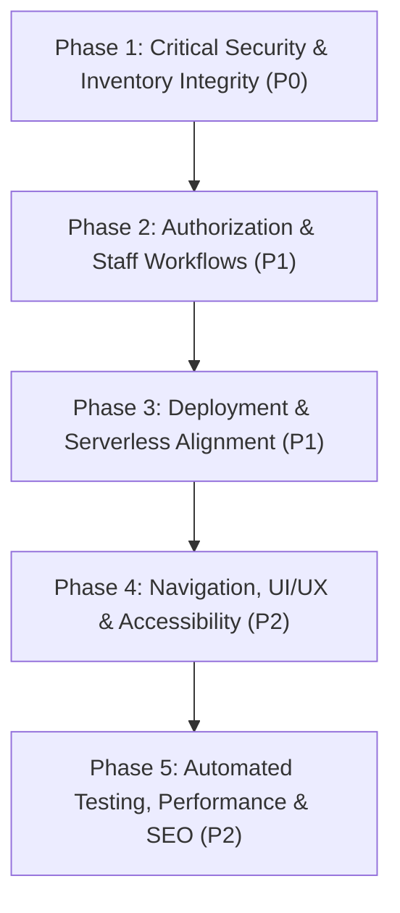

# Roomly Master Remediation Roadmap & Consolidated Defect Registry

## 1. Remediation Phases & Implementation Strategy

All identified defects are cataloged and sequenced into five focused engineering phases. Remediations must be executed in small, logically grouped commits accompanied by regression tests.

---

## 2. Phase Breakdown

### Phase 1: Critical Security & Inventory Integrity (P0 — Immediate)
*Goal: Eliminate financial fraud, cross-site credential leakage, and database inventory corruption.*

1. **Fix CORS Permissive Origin Reflection (`SEC-001`)**:
   - In [`apps/api/src/app.ts`](file:///c:/Users/bs162/Desktop/Roomly/apps/api/src/app.ts), remove unconditional `callback(null, true)`. Restrict allowed origins strictly to `env.CLIENT_URL` and sanctioned preview domains. Reject untrusted origins with an explicit error.
2. **Prevent Cross-Tenant Refund IDOR (`SEC-002`)**:
   - In [`apps/api/src/modules/payments/payments.service.ts`](file:///c:/Users/bs162/Desktop/Roomly/apps/api/src/modules/payments/payments.service.ts), verify `payment.hotelId.toString() === staffHotelId` before initiating refund.
3. **Fix Race Condition in Inventory Provisioning (`INV-001`)**:
   - In [`apps/api/src/modules/inventory/inventory.service.ts`](file:///c:/Users/bs162/Desktop/Roomly/apps/api/src/modules/inventory/inventory.service.ts), replace the non-atomic check-then-create with an atomic `findOneAndUpdate({ ... }, { $setOnInsert: { totalInventory }, $inc: { heldCount: 1 } }, { upsert: true })`.
4. **Prevent Negative Hold Counts & Inventory Overselling (`INV-002`)**:
   - In `confirmHoldToBooked`, enforce `{ heldCount: { $gt: 0 } }`. In `payments.service.ts`, wrap confirmation in an atomic status transition `Booking.findOneAndUpdate({ _id, status: 'PENDING_PAYMENT' }, { $set: { status: 'CONFIRMED' } })`.
5. **Fix Double Cancellation Inventory Wipe (`INV-003`)**:
   - In `bookings.service.ts`, atomically transition booking status to `CANCELLED` before calling `releaseBookedInventory`.
6. **Guard Production Auto-Seeding (`SEC-003`)**:
   - In [`apps/api/src/server.ts`](file:///c:/Users/bs162/Desktop/Roomly/apps/api/src/server.ts), restrict `seedData(false)` strictly to non-production environments (`env.NODE_ENV !== 'production'`).

---

### Phase 2: Authorization, Tenant Guards & Core Workflows (P1 — High)
*Goal: Restore staff operational access and enforce proper multi-tenant role boundaries.*

1. **Restore Staff Access to `GET /api/v1/bookings/:id` (`API-001`)**:
   - In `bookings.service.ts`, check user's `HotelMembership` against `booking.hotelId`.
2. **Fix Missing Tenant Context on Refund Endpoint (`API-002`)**:
   - In `payments.routes.ts`, resolve hotel membership dynamically from the target payment rather than requiring artificial `?hotelId=...` parameters.
3. **Prevent Concurrency in Physical Room Assignment (`INV-005`)**:
   - In `operations.service.ts`, check in rooms using atomic conditional updates: `Room.findOneAndUpdate({ _id, status: 'AVAILABLE' }, { $set: { status: 'OCCUPIED' } })`.
4. **Enforce Frontend Route Guards (`FE-001`)**:
   - Create `<ProtectedRoute>` in `apps/web/src/components/common/ProtectedRoute.tsx` and wrap `/dashboard`, `/staff/*`, `/manager/*`, and `/admin/*`.
5. **Enforce Strict Production JWT Secrets (`SEC-004`)**:
   - In `apps/api/src/config/env.ts`, require non-default JWT secrets when `NODE_ENV === 'production'`.

---

### Phase 3: Deployment & Serverless Alignment (P1 — High)
*Goal: Ensure seamless build, execution, and scheduled task operation on Vercel.*

1. **Fix `vercel.json` Deployment Configuration (`DEP-001`)**:
   - Replace invalid `"services"` block with valid Vercel build/functions routing or split into two dedicated Vercel projects.
2. **Implement Vercel Cron for Hold Expiration (`DEP-002`)**:
   - Expose `POST /api/v1/jobs/release-expired-holds` with a secret bearer token. Add Vercel Cron schedule (`* * * * *`) in `vercel.json`.
3. **Increase Database Connection Timeout for Serverless Cold Starts (`DEP-003`)**:
   - Adjust `serverSelectionTimeoutMS` to 10,000ms in `connection.ts`.
4. **Fix Direct Navigation Infinite Hang on `/checkout` (`NAV-003`)**:
   - Add fallback check in `CheckoutPage.tsx` when query parameters are missing.
5. **Fix Operational Dashboard Infinite Loading (`NAV-004`)**:
   - Handle absence of hotel membership gracefully with an error screen rather than an early return.

---

### Phase 4: Navigation, UI/UX & Accessibility Polish (P2 — Medium)
*Goal: Deliver a flawless Luxury Editorial experience across all viewports.*

1. **Fix Header Hash Anchors on Subpages (`NAV-001`)**:
   - Update `#story` and `#amenities` to navigate to `/#story` and `/#amenities`.
2. **Implement Branded Editorial 404 Page (`NAV-002`)**:
   - Create `NotFoundPage.tsx` and attach to `<Route path="*" element={<NotFoundPage />} />`.
3. **Implement Mobile Navigation Drawer (`UIX-001`)**:
   - Add responsive hamburger drawer menu for screen widths `<= 768px`.
4. **Resolve WCAG 2.2 AA Contrast Failures (`UIX-002`)**:
   - Use Deep Charcoal (`#24231F`) text on Champagne Gold buttons (`5.81:1` ratio). Darken accent gold for standalone text on light backgrounds to `#8C6E3D`.
5. **Restore Focus Visibility Rings (`UIX-003`)**:
   - Add `.btn:focus-visible` outline styles in `luxury.css`.
6. **Connect Footer Policy Links (`NAV-005`) & Contextual Hotel Links (`NAV-006`)**:
   - Implement policy modals/pages and pass hotel IDs in footer links.

---

### Phase 5: Automated Testing, Performance & SEO (P2 — Medium)
*Goal: Establish robust test coverage, fast load times, and search engine discoverability.*

1. **Implement Frontend Vitest & React Testing Library Suite (`FE-002`)**:
   - Add component and integration tests in `apps/web/src/__tests__/`.
2. **Implement Route-Level Code Splitting (`PERF-001`)**:
   - Convert static page imports to `React.lazy` with `Suspense` and configure `manualChunks` in `vite.config.ts`.
3. **Refactor Unbounded Reporting Aggregations (`API-003`)**:
   - Implement MongoDB `$match` and `$group` aggregation pipelines with mandatory date range parameters.
4. **Resolve Dependency Vulnerabilities (`SEC-005`)**:
   - Update `tinypool`, `nodemailer`, `zod`, and `react-router` to secure versions.
5. **Implement Robots.txt, Sitemap.xml & Schema.org Structured Data (`SEO-001` - `SEO-003`)**:
   - Create `apps/web/public/robots.txt` and `sitemap.xml`, and add JSON-LD hotel structured data.

---

## 3. Master Consolidated Defect Registry

| Finding ID | Severity | Priority | Module | Affected File / Route | Defect Title & Summary |
| :--- | :---: | :---: | :--- | :--- | :--- |
| **SEC-001** | **CRITICAL** | P0 | Security | `apps/api/src/app.ts` | CORS arbitrary origin reflection with `credentials: true`. |
| **SEC-002** | **CRITICAL** | P0 | Security / Auth | `modules/payments/payments.service.ts` | Cross-tenant IDOR allows refunding payments of other hotels. |
| **INV-001** | **CRITICAL** | P0 | Inventory | `modules/inventory/inventory.service.ts`| Concurrent holds on uninitialized dates crash with `E11000`. |
| **INV-002** | **CRITICAL** | P0 | Inventory / Pay | `modules/inventory/inventory.service.ts`| Double payment confirmation drives `heldCount` negative (`-1`). |
| **INV-003** | **CRITICAL** | P0 | Bookings | `modules/bookings/bookings.service.ts` | Concurrent cancellation releases inventory multiple times. |
| **SEC-003** | **HIGH** | P0 | Security / DB | `apps/api/src/server.ts` | Production bootstrap auto-seeds demo properties with known passwords. |
| **SEC-004** | **HIGH** | P1 | Security / Env | `apps/api/src/config/env.ts` | Insecure hardcoded default fallback secrets for JWT tokens. |
| **API-001** | **HIGH** | P1 | Bookings / API | `modules/bookings/bookings.routes.ts` | Staff and Hotel Managers locked out of `GET /bookings/:id` (403). |
| **API-002** | **HIGH** | P1 | Payments / API | `modules/payments/payments.routes.ts` | Missing tenant context causes 400 error on valid refunds. |
| **INV-004** | **HIGH** | P1 | Jobs / Deploy | `jobs/holdExpirationJob.ts` | In-memory `setInterval` hold expiration fails in serverless. |
| **INV-005** | **HIGH** | P1 | Operations | `modules/operations/operations.service.ts`| Front desk check-in physical room assignment race condition. |
| **DEP-001** | **HIGH** | P1 | Deployment | `vercel.json` | Invalid `"services"` schema block triggers deployment failure. |
| **FE-001** | **HIGH** | P1 | Frontend / Nav | `apps/web/src/App.tsx` | Operational dashboards lack route guards (`ProtectedRoute`). |
| **FE-002** | **HIGH** | P1 | Testing | `apps/web/package.json` | Frontend test runner exits with code 1 due to 0 test files. |
| **NAV-003** | **HIGH** | P1 | Navigation | `apps/web/src/pages/CheckoutPage.tsx` | Navigating to `/checkout` without parameters freezes in infinite load. |
| **NAV-004** | **HIGH** | P1 | Navigation | `StaffDashboardPage.tsx` / `ManagerPage` | Dashboards hang indefinitely when accessed by guests/admins. |
| **API-003** | **MEDIUM** | P2 | Reports | `modules/reports/reports.service.ts` | Flawed occupancy calculation and unbounded historical queries. |
| **API-004** | **MEDIUM** | P2 | Auth / API | `modules/auth/auth.routes.ts` | Password reset, forgot password, and email verification missing. |
| **INV-006** | **MEDIUM** | P2 | Payments / Adap | `adapters/payment/index.ts` | Stripe and Razorpay SDKs not implemented; only mock exists. |
| **SEC-005** | **MEDIUM** | P2 | Dependencies | `package.json` | 10 known vulnerabilities reported by `npm audit` (2 critical). |
| **SEC-006** | **MEDIUM** | P2 | Security | `apps/api/src/app.ts` | Helmet Content Security Policy explicitly disabled. |
| **DEP-003** | **MEDIUM** | P2 | Database / Dep | `apps/api/src/db/connection.ts` | 2000ms database timeout causes cold-start failures in serverless. |
| **FE-003** | **MEDIUM** | P2 | Frontend | `apps/web/src/pages/CheckoutPage.tsx` | Unauthenticated checkout pre-populates with hardcoded demo guest data. |
| **FE-004** | **MEDIUM** | P2 | Frontend | `apps/web/src/main.tsx` | Lack of top-level React Error Boundary. |
| **NAV-001** | **MEDIUM** | P2 | Navigation | `apps/web/src/components/common/Header.tsx`| Hash links `#story` and `#amenities` broken on non-home routes. |
| **NAV-002** | **MEDIUM** | P2 | Navigation | `apps/web/src/App.tsx` | Catch-all route silently redirects to `/` instead of branded 404. |
| **UIX-001** | **MEDIUM** | P2 | Responsive | `apps/web/src/components/common/Header.tsx`| Missing mobile drawer menu causes overflow on viewports < 768px. |
| **UIX-002** | **MEDIUM** | P2 | Accessibility | `luxury.css` / `.btn-gold` | Champagne Gold on White fails WCAG 2.2 AA contrast (2.5:1). |
| **PERF-001**| **MEDIUM** | P2 | Performance | `apps/web/src/App.tsx` | Monolithic 774 kB JS bundle without route-level code splitting. |
| **SEC-007** | **LOW** | P3 | Security | `apps/web/src/context/AuthContext.tsx` | Plaintext passwords for demo personas exposed in production JS bundle. |
| **NAV-005** | **LOW** | P3 | Navigation | `apps/web/src/components/common/Footer.tsx`| Footer policy links are non-interactive plain `` tags. |
| **NAV-006** | **LOW** | P3 | Navigation | `apps/web/src/components/common/Footer.tsx`| Footer hotel links navigate to generic `/rooms` without property ID. |
| **FE-005** | **LOW** | P3 | Accessibility | `BookingBar.tsx` / `LoginPage.tsx` | Form `<label>` tags lack `htmlFor` / `id` associations. |
| **UIX-003** | **LOW** | P3 | Accessibility | `apps/web/src/styles/luxury.css` | `.btn { outline: none; }` strips keyboard focus visibility rings. |
| **UIX-004** | **LOW** | P3 | Accessibility | `RoomDetailsModal.tsx` | Image carousel pagination dots lack accessible screen reader names. |
| **PERF-002**| **LOW** | P3 | Performance | `Hero.tsx` / `RoomCard.tsx` | Below-the-fold high-resolution images lack `loading="lazy"`. |
| **PERF-003**| **LOW** | P3 | Performance | `apps/web/index.html` | External Google Fonts stylesheet is render-blocking. |
| **SEO-001** | **LOW** | P3 | SEO | `apps/web/index.html` | Static single page title and description used across all routes. |
| **SEO-002** | **INFO** | P4 | SEO | `apps/web/index.html` | Missing canonical URLs, Open Graph tags, and Schema.org JSON-LD. |
| **SEO-003** | **INFO** | P4 | SEO | `apps/web/public/` | Missing `robots.txt` and `sitemap.xml` files. |

